# agent-kb

Your coding-agent sessions, turned into a second brain you can search, resume and build on.

> **Status: pre-alpha.** On `main` today: capture from Claude Code, the Desktop Code tab and Cowork (sweeper + SessionEnd hook), chat import from Claude's data export and `kb_save`, secret redaction, opt-in summaries, Obsidian notes out and vault notes in, and search through the MCP server and CLI. Install as a Claude Code plugin or a Claude Desktop `.mcpb` (see [Install](#install)). See [docs/PLAN.md](docs/PLAN.md).

  

## Why

You spend hours a day with coding agents. Every decision, dead end and "oh, *that's* why"
lives in a transcript that you never open again. agent-kb collects those sessions from the
tools you already use, summarizes them into a local, searchable knowledge base, and hands
that context back to your agents — and to you in Obsidian.

## What's different: sessions that never end

Collect, store, search — most memory tools do that. The difference is *what gets lost*.
Capture that waits for a session to end misses every session that doesn't end cleanly:
the Claude Desktop session left open for days, the crashed run, the chat that lives only
in the cloud, and everything from before you installed it.

  

agent-kb decides what to capture by **what changed on disk**, not by whether a session
closed — so a session left open gets summarized in chunks, a crashed one is caught on the
next sweep, history still on disk is indexed by `agent-kb backfill`, and chats come in through
`kb_save` or Claude's data export.

## A second brain that writes itself

A second brain is a personal knowledge system: notes you capture once and find again when
they matter. Most never get built, because writing the notes is the hard part. With agents,
the thinking already happens in writing — it just ends up in transcripts nobody reads.

agent-kb turns that by-product into the notes (see [phases 3–6](docs/PLAN.md)):

- **Captured for you.** Every session becomes a dated note: your prompts and, with summaries on, its decisions, what was learned, files touched and open questions. No end-of-day journaling.
- **Lives in your vault.** Point it at an Obsidian vault and the notes land there as Markdown with frontmatter and `[[links]]`, next to your own writing, in the graph view.
- **Flows both ways.** Notes *you* write in the vault are indexed back, so your agents can draw on them too. Notes agent-kb writes are tagged `generator: agent-kb` and never re-ingested as if you had written them.
- **Yours.** Plain files and one SQLite database on your disk (the database exists today). Uninstall agent-kb and the notes stay.

## What it does

| | |
|---|---|
| **Capture** | Sweeps session transcripts from Claude Code and Claude Desktop (Code tab, Cowork) via adapters; other harnesses are planned. No "session end" required: an idle sweeper summarizes long-lived sessions in chunks. |
| **Summarize** | Each session becomes a short structured note (decisions, knowledge, files, open questions). Uses *your* model access: the `claude` CLI or your own API key. |
| **Redact** | Secrets are stripped by deterministic rules (patterns + entropy) **before** anything is sent to a model or written to disk. |
| **Search** | Local SQLite FTS5 with recency-aware ranking. Exposed to agents as an MCP server (`kb_query`, `kb_get`). |
| **Resume / fork** (planned) | Every session carries a resume command. Find a past session by what it was about, jump back into it, or fork it into a different harness with a handoff prompt. |
| **Obsidian** | Optional. Pick a vault: sessions and a daily journal are written as notes with frontmatter and `[[links]]`; your vault notes are indexed back into search. |

**Chats:** Claude *chat* conversations live only in the cloud, so the sweeper can't see them.
They come in two ways instead: live, by saving a chat through the MCP server (`kb_save`, Claude Desktop),
and in bulk, by importing Claude's official data export (`agent-kb import <manifest.json>` — it lists any file still to download, with its link to open in your signed-in browser).
The Desktop Code tab and Cowork run locally and are captured automatically.

## Principles (design)

- **Local-first.** Your knowledge base is a SQLite file on your machine. No account, no sync service.
- **Explicit about data flow.** The only thing that leaves your machine is redacted transcript text sent to the model provider *you* configured, for summarization. Setup says so.
- **Hooks accelerate, sweeps guarantee.** End-of-session hooks are an optimization; a sweeper catches crashed, killed and never-closed sessions.
- **Judgment is measured, not assumed.** Optional model-based triage only switches on once it beats a threshold on your own corrections.

## Install

Needs Node >= 22.16 (the plugin's launcher prints a hint when it is missing; Claude Code's native installer ships no Node).

- **Claude Code:** `/plugin marketplace add stonghuuloc/agent-kb`, then `/plugin install agent-kb@agent-kb`, then `/agent-kb-setup`. The first start runs `npm ci` for the three dependencies. The launcher is a POSIX shell script, so Windows needs Git Bash.
- **Claude Desktop:** `npm run pack:mcpb` builds `dist/agent-kb.mcpb`; open it in Desktop for the install form (sources, summaries, vault, API key in the OS keychain). Desktop runs it on its built-in Node (24.x).

### First run: what it reads, sends and writes

**What agent-kb reads:** the transcripts of your coding-agent sessions on this machine (Claude Code, and the Claude Desktop Code tab and Cowork), plus chats you save or import yourself, plus the Markdown notes in your vault directory if you set one (indexed locally).

**What leaves this machine:** only what a model sees. When an agent calls `kb_query` or `kb_get`, the redacted notes it gets back (sessions and vault notes) go to that agent's model provider. With summaries on, redacted transcript text also goes to the provider you chose: your own `claude` CLI account, or the Anthropic API with your key. Secrets are removed by fixed rules before any write and before any model call. With summaries on, new sessions are summarized automatically (idle sweeps and the session-end hook); a bulk run over past sessions asks first and shows its estimate.

**Where files are written:** one SQLite database in the agent-kb data directory (macOS `~/Library/Application Support/agent-kb`, Linux `~/.local/share/agent-kb`, Windows `%LOCALAPPDATA%\agent-kb`). With a vault directory set, Markdown notes go to `<vault>/<folder>/`. Nothing else is written.

## License

MIT
