# agent-kb

Your coding-agent sessions, turned into a second brain you can search, resume and build on.

> **Status: pre-alpha.** On `main` today: capture from Claude Code, the Desktop Code tab and Cowork (sweeper + SessionEnd hook), chat import from Claude's data export and `kb_save`, secret redaction, opt-in summaries, Obsidian notes out and vault notes in, and search through the MCP server and CLI. Install as a Claude Code plugin or a Claude Desktop `.mcpb` (see [Install](#install)). See [docs/PLAN.md](docs/PLAN.md).

<p align="center">
  
</p>

## Install

### Claude Desktop (easiest)

1. **[Download agent-kb.mcpb](https://github.com/stonghuuloc/agent-kb/releases/latest/download/agent-kb.mcpb).** One file, nothing to clone.
2. Double-click it. Claude Desktop opens an install dialog. (If it doesn't, open Desktop, go to Settings > Extensions and drag the file in.)
3. Fill in the form using the [settings table](#settings) below, then click Install.

The form is the whole setup; there is no slash command in this route.

### Claude Code (also works in the Desktop Code tab)

Needs Node >= 22.16. Run these in a session:

```
/plugin marketplace add stonghuuloc/agent-kb
/plugin install agent-kb@agent-kb
/agent-kb:agent-kb-setup
```

The last command is the important one. It asks which sources to index, whether to turn summaries on, and which Obsidian vault to write to, then indexes your past sessions. If you skip it, one of your next new sessions shows a one-time reminder to run it.

### Settings

| Setting | What to put | Default |
|---|---|---|
| **Summaries** | `claude` = your own `claude` CLI writes the notes (recommended). `api` = Anthropic API, needs a key. `off` = search only, no notes. | `off` |
| **Obsidian vault directory** | Full path to your vault's root folder (the one containing `.obsidian`), e.g. `/Users/you/Documents/my-vault`. Blank = no Obsidian notes. | blank |
| **Vault folder** | Subfolder inside the vault for agent-kb's notes, e.g. `agent-kb`. Created for you. | `agent-kb` |
| **Anthropic API key** | Only when Summaries = `api`. Stored in your OS keychain. | blank |
| **Sources** | Blank = everything. Or a comma list of `claude-code`, `claude-desktop-code`, `claude-cowork`. | blank |

**Summaries are off until you turn them on**, because `claude` and `api` send redacted transcript text to a model provider. See [Privacy](#privacy-what-it-reads-sends-and-writes).

Maintainer notes: the first start runs `npm ci` for three dependencies; the MCP server starts through `node hooks/launch.cjs` on every OS; hooks run through Git Bash on Windows; Desktop uses its built-in Node (24.x); build the bundle with `npm run pack:mcpb`.

## Why

You spend hours a day with coding agents. Every decision, dead end and "oh, *that's* why"
lives in a transcript that you never open again. agent-kb collects those sessions from the
tools you already use, summarizes them into a local, searchable knowledge base, and hands
that context back to your agents — and to you in Obsidian.

## What's different: sessions that never end

Collect, store, search — most memory tools do that. The difference is *what gets lost*.
Capture that waits for a session to end misses every session that doesn't end cleanly:
the Claude Desktop session left open for days, the crashed run, the chat that lives only
in the cloud, and everything from before you installed it.

<p align="center">
  
</p>

agent-kb decides what to capture by **what changed on disk**, not by whether a session
closed — so a session left open gets summarized in chunks, a crashed one is caught on the
next sweep, history still on disk is indexed by `agent-kb backfill`, and chats come in through
`kb_save` or Claude's data export.

## A second brain that writes itself

A second brain is a personal knowledge system: notes you capture once and find again when
they matter. Most never get built, because writing the notes is the hard part. With agents,
the thinking already happens in writing — it just ends up in transcripts nobody reads.

agent-kb turns that by-product into the notes (see [phases 3–6](docs/PLAN.md)):

- **Captured for you.** Every session becomes a dated note: your prompts and, with summaries on, its decisions, what was learned, files touched and open questions. No end-of-day journaling.
- **Writes your worklog.** With a vault set, each summary's journal lines land in `<vault>/daily/<today>.md` under `## What I did`, `## What I learned / figured out`, `## Friction — what slowed me down` and `## What I searched / asked for today`, with `[ticket]` / `[agent]` prefixes, `[[TICKET]]` links and a `tickets:` front-matter union. It only appends: your own lines in that note are never rewritten. `AGENT_KB_DAILY_DIR` moves the folder (default `daily` in the vault); `AGENT_KB_DAILY=off` turns it off.
- **Lives in your vault.** Point it at an Obsidian vault and the notes land there as Markdown with frontmatter and `[[links]]`, next to your own writing, in the graph view.
- **Flows both ways.** Notes *you* write in the vault are indexed back, so your agents can draw on them too. Notes agent-kb writes are tagged `generator: agent-kb` and never re-ingested as if you had written them.
- **Learns what went wrong.** Friction lines from each session are distilled into proposed rules in `~/.claude/learned-proposals.md` — a staging file you review, never `CLAUDE.md`.
- **Yours.** Plain files and one SQLite database on your disk (the database exists today). Uninstall agent-kb and the notes stay.

## What it does

| | |
|---|---|
| **Capture** | Sweeps session transcripts from Claude Code and Claude Desktop (Code tab, Cowork) via adapters; other harnesses are planned. No "session end" required: an idle sweeper summarizes long-lived sessions in chunks. |
| **Graph + concept notes** | Tickets, PRs, repos and Confluence pages become entities and edges; one note per worked ticket and per repo lands in `<vault>/concepts/`, with a generated region that rebuilds and a `## Notes` section that stays yours. `agent-kb graph build`, `agent-kb graph query CH-58201`, `kb_graph` from an agent. |
| **Backfills** | `agent-kb backfill-remote` pulls Jira tickets, GitHub PRs and Confluence pages you touched (`GH_TOKEN`, `ATLASSIAN_PAT`, `ATLASSIAN_EMAIL`, or `--env <dotenv>`), so recall answers from the ticket itself. `agent-kb import-kb` brings a whole `~/.claude/kb.sqlite` across. |
| **Index your own files** | `agent-kb index` reads the docs you already wrote: `CLAUDE.md` / `AGENTS.md` / `README.md` at repo roots, every `docs/**.md`, `.claude/{skills,commands,agents}`, `~/.claude/{CLAUDE.md,skills,commands,agents,plans,references,hooks}` and `~/.claude/projects/*/memory/*.md`, so questions answered in your rules files come back through `kb_query`. Set `AGENT_KB_WORKSPACE` to the folder holding your repos; it runs on every sweeper tick. |
| **Summarize** | Each session becomes a structured note (tickets, files, commits/PRs, knowledge, decisions, error fixes, commands, open questions) plus journal lines for the daily note. Uses *your* model access: the `claude` CLI or your own API key. |
| **Redact** | Secrets are stripped by deterministic rules (patterns + entropy) **before** anything is sent to a model or written to disk. |
| **Search** | Local SQLite FTS5 with recency-aware ranking. Exposed to agents as an MCP server (`kb_query`, `kb_get`). |
| **Resume / fork** (planned) | Every session carries a resume command. Find a past session by what it was about, jump back into it, or fork it into a different harness with a handoff prompt. |
| **Obsidian** | Optional. Pick a vault: sessions and a daily journal are written as notes with frontmatter and `[[links]]`; your vault notes are indexed back into search. |

**Chats:** Claude *chat* conversations live only in the cloud, so the sweeper can't see them.
They come in two ways instead: live, by saving a chat through the MCP server (`kb_save`, Claude Desktop),
and in bulk, by importing Claude's official data export (`agent-kb import <manifest.json>` — it lists any file still to download, with its link to open in your signed-in browser).
The Desktop Code tab and Cowork run locally and are captured automatically.

## Resume and fork

```
agent-kb resume <words…>              # best match with a resume command; prints it, never runs it
agent-kb fork <words…> [--to claude]  # handoff prompt (notes + transcript path + "re-check live state")
```

`resume` writes the matched session to stderr and only the command to stdout. A deleted transcript, a Cowork session or a chat says what to do instead (open Desktop, open the link, or `fork`).
`fork` prints the redacted prompt. With `--to claude` it writes the prompt to a private temp file and prints a command that starts a new `claude` in the session's folder with it; any other `--to` prints the prompt alone. The MCP server exposes the same as `kb_resume` and `kb_fork`.

Shell shortcut: add one line to your rc file, then `kbr <words…>` shows the command and runs it only after `y`.

```sh
eval "$(agent-kb shell-init zsh)"        # bash: same with bash
agent-kb shell-init fish | source        # fish
```

**SessionStart context.** The plugin's SessionStart hook adds up to 5 recent sessions for the current folder (title, one line, doc path; at most 2K chars) to the new session's context. `AGENT_KB_CONTEXT=off` turns it off; it prints nothing without a kb file and never fails the session.

**Prompt recall.** The `UserPromptSubmit` hook searches the kb with your prompt — two terms minimum, stopwords dropped — and adds the top 2 matches (one per source type, 2.5K chars, with a *this is memory, re-check live state* line). Notes from another project are dropped when the session's own folder is known, and `confluence_page` is left out unless asked for. `AGENT_KB_PROMPT=off` turns it off, `AGENT_KB_PROMPT_LIMIT` changes the slot count, `AGENT_KB_PROMPT_EXCLUDE_TYPES` the type list. It never creates a kb file and never fails a prompt.

## Principles (design)

- **Local-first.** Your knowledge base is a SQLite file on your machine. No account, no sync service.
- **Explicit about data flow.** The only thing that leaves your machine is redacted transcript text sent to the model provider *you* configured, for summarization. Setup says so.
- **Hooks accelerate, sweeps guarantee.** End-of-session hooks are an optimization; a sweeper catches crashed, killed and never-closed sessions.
- **Judgment is measured, not assumed.** Optional model-based triage only switches on once it beats a threshold on your own corrections.

## Privacy: what it reads, sends and writes

**What agent-kb reads:** the transcripts of your coding-agent sessions on this machine (Claude Code, and the Claude Desktop Code tab and Cowork), plus chats you save or import yourself, plus the Markdown notes in your vault directory if you set one (indexed locally).

**What agent-kb reads:** the transcripts of your coding-agent sessions on this machine (Claude Code, and the Claude Desktop Code tab and Cowork), plus chats you save or import yourself, plus the Markdown notes in your vault directory if you set one (indexed locally).

**What leaves this machine:** only what a model sees. When an agent calls `kb_query`, `kb_get`, `kb_resume` or `kb_fork`, the redacted notes it gets back (sessions and vault notes) go to that agent's model provider. The Claude Code plugin's SessionStart hook also adds a short list of recent sessions for the current folder to each new session, so that list goes to the model provider too (off with `AGENT_KB_CONTEXT=off`). The plugin's `UserPromptSubmit` hook also searches the kb with the user's own prompt and adds up to 2 matching notes that way, so those notes go to the model provider too (off with `AGENT_KB_PROMPT=off`). With summaries on, redacted transcript text also goes to the provider you chose: your own `claude` CLI account, or the Anthropic API with your key. Secrets are removed by fixed rules before any write and before any model call. With summaries on, new sessions are summarized automatically (idle sweeps and the session-end hook); a bulk run over past sessions asks first and shows its estimate.

**Where files are written:** one SQLite database in the agent-kb data directory (macOS `~/Library/Application Support/agent-kb`, Linux `~/.local/share/agent-kb`, Windows `%LOCALAPPDATA%\agent-kb`). With a vault directory set, Markdown notes go to `<vault>/<folder>/`. A small marker file `setup-hint-shown` in the same directory records that the setup reminder was shown. With a vault directory set, each summary's journal lines are appended to `<vault>/daily/<date>.md` (folder moved with `AGENT_KB_DAILY_DIR`, switched off with `AGENT_KB_DAILY=off`), created from a template when absent; the rest of that note is never rewritten. `agent-kb backfill-remote` reads your Jira tickets, GitHub PRs and Confluence pages with the tokens in your environment and stores them locally; nothing from those fetches goes to a model. Concept notes in `<vault>/concepts/` are written with a generated region that is rebuilt from the local graph. `agent-kb distill` writes proposed rules to `~/.claude/learned-proposals.md`. `fork --to claude` (CLI or `kb_fork`) writes its handoff prompt to a private file in the system temp folder (`agent-kb-fork-*/handoff.md`), which the new session reads; it stays until the OS clears that folder. Nothing else is written.

## License

MIT
